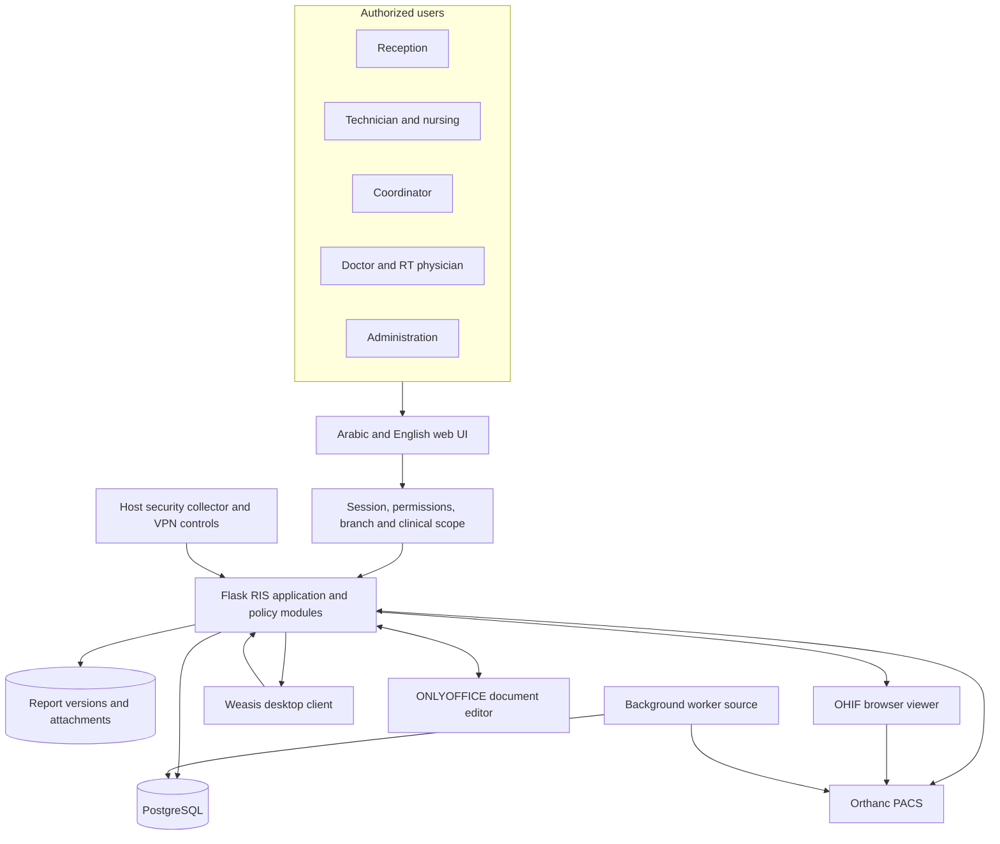
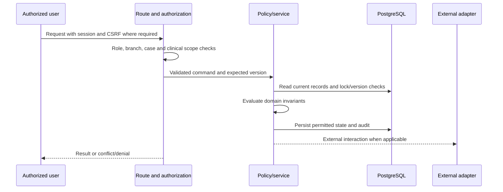
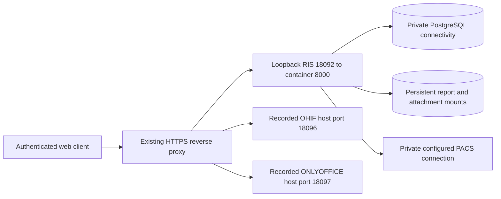

# Architecture blueprint

## 1. Current architecture: a modularizing monolith

RadBridge RIS remains one Flask/Gunicorn application with shared SQLAlchemy metadata and PostgreSQL. `ris/app.py` contains ORM definitions, routes and legacy orchestration; focused modules extract policy and services. Those modules are **logical components inside the same application**, not independent microservices. The viewer, document editor and PACS are external runtime components.

The arrows show logical data dependencies, not permission-free/public connections. Viewer access must follow the deployed authorized path; this is not a recommendation to expose Orthanc. Worker declarations and security screens require separate host/runtime checks.

## 2. Component map and responsibilities

| Logical component | Source anchors | Responsibility / boundary |
|---|---|---|
| Registration and scheduling | [registration_policy.py](../../ris/registration_policy.py), [procedure_catalog.py](../../ris/procedure_catalog.py), [app.py](../../ris/app.py) | Patient/order/accession, procedure, branch and scheduling |
| Staff execution | [procedure_staff_workflow.py](../../ris/procedure_staff_workflow.py), [workflow_engine.py](../../ris/workflow_engine.py) | Per-code responsibilities and exam transitions |
| Reconciliation | [dicom_reconciliation.py](../../ris/dicom_reconciliation.py), [pacs_resolution_service.py](../../ris/pacs_resolution_service.py) | Compare incoming PACS study with the true RIS order; permitted correction |
| Readiness | [case_readiness_service.py](../../ris/case_readiness_service.py), [readiness_operations.py](../../ris/readiness_operations.py) | Evaluate blockers independently of report labels |
| Assignment | [case_assignment_service.py](../../ris/case_assignment_service.py), [assignment_decision_engine.py](../../ris/assignment_decision_engine.py) | Coordinator/automatic assignment policy and eligibility |
| Reporting | [report_transaction_writer.py](../../ris/report_transaction_writer.py), [report_state_transition.py](../../ris/report_state_transition.py) | Explicit version commits, verification and final locking |
| Editor adapter | [onlyoffice_report_bridge.py](../../ris/onlyoffice_report_bridge.py) | Editor callbacks/working copy vs committed report |
| Imaging adapters | [viewer_choice.py](../../ris/viewer_choice.py), [ohif_identity.py](../../ris/ohif_identity.py), [pacs_worker.py](../../ris/pacs_worker.py) | Study-scoped viewer delivery and PACS background work |
| Identity/access | [user_access_policy.py](../../ris/user_access_policy.py), [clinical_scope.py](../../ris/clinical_scope.py) | Role, branch, modality, device, room and direct URL restrictions |
| Revision/settlement | [report_revisions.py](../../ris/report_revisions.py), [replacement_settlements.py](../../ris/replacement_settlements.py) | Preserve original final report and financial audit trail |
| Manual radiotherapy | [radiotherapy.py](../../ris/radiotherapy.py), [radiotherapy_migration.py](../../ris/radiotherapy_migration.py) | External approved plan record, PET links and manual sessions |
| Operations/security | [security_dashboard.py](../../ris/security_dashboard.py), [backup_worker.py](../../ris/backup_worker.py) | Restricted dashboard and backup source; host services remain external |

## 3. Request/transaction boundary

This is a **desired review pattern**, not a claim that every legacy route has already been refactored into it. External network operations cannot be assumed atomic with a SQL transaction. For each actual operation, inspect whether the call occurs before/after commit, how retry is deduplicated, and what happens if an acknowledgement is lost.

## 4. Recorded deployment topology

The checkpoint recorded current RIS image `radbridge-ris:radiotherapy-cf59dc1-20261009` and a stopped rollback `radbridge-ris-rollback-radiotherapy-20261009`. Private networking, credentials, proxy rules and complete infrastructure configuration are not exported. Verify current topology before deployment; source Compose examples have historical names/ports.

## 5. Proposed evolution: not implemented

Prefer gradual extraction within the monolith before separate services. Move one policy boundary at a time out of route orchestration, inject adapters, and retain URLs/data/report identity. Candidate seams are registration, readiness, assignment, report versioning and external PACS/editor adapters. Keep one authoritative writer for each domain operation.

A future separate worker/service needs explicit ownership, durable job state, message versioning, idempotency, retries, audit correlation and compatibility/rollback contracts. No new broker, service, port, schema split or infrastructure dependency is introduced by this blueprint. Whether microservices are worthwhile is an unresolved design decision, not an approved migration.
