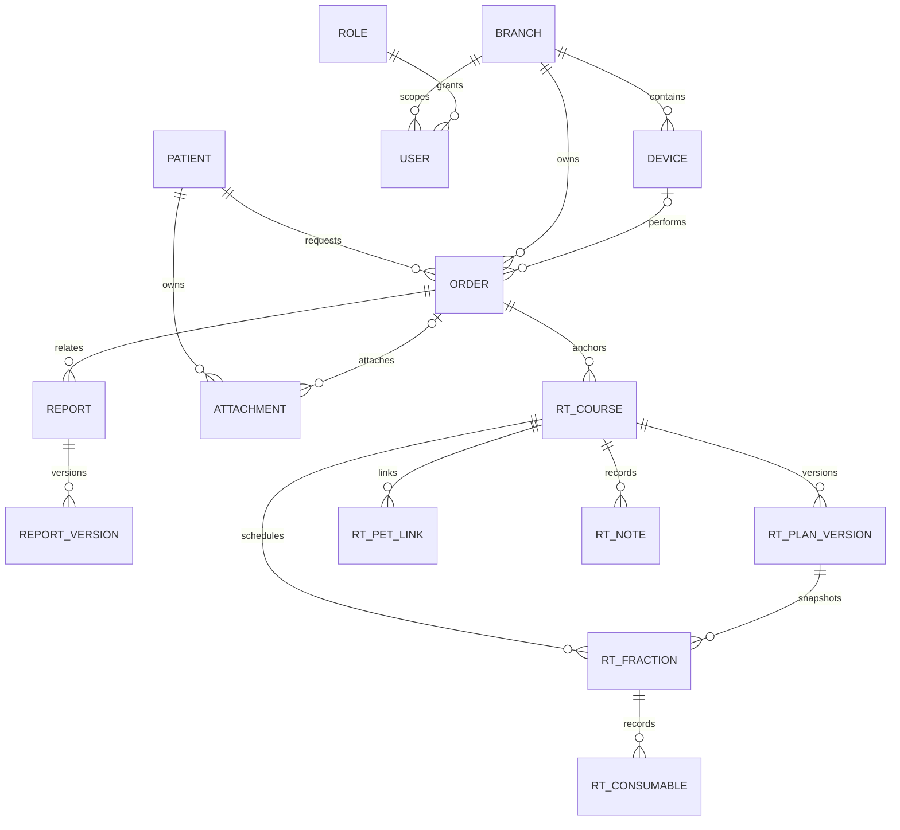
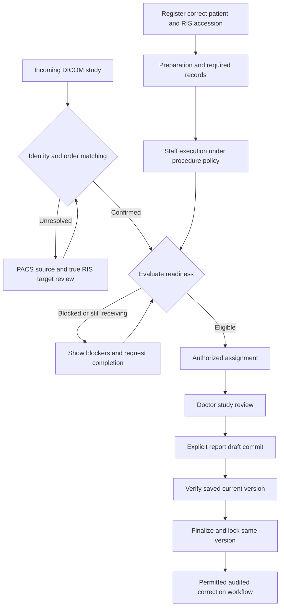
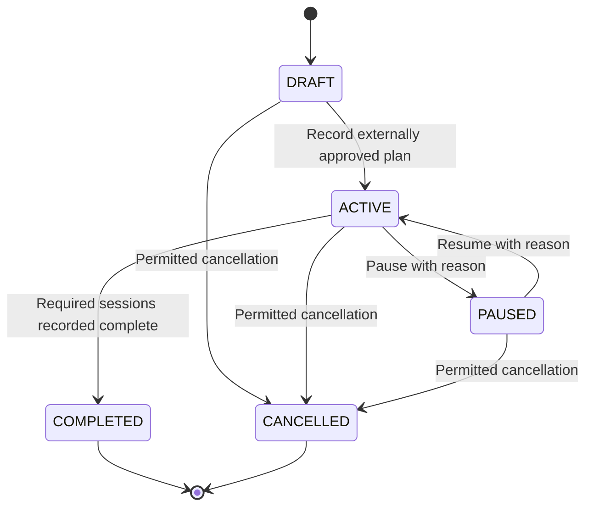

# Data and workflow blueprint

## 1. Core data relationships

This is a selected conceptual relationship map derived from ORM fields, not complete executable DDL. Consult the [ORM inventory](../handover/ORM_INVENTORY.md) and source constraints before migration.

The diagram deliberately does not impose unverified one-report-per-order uniqueness. ORM column declarations, composite constraints and actual stored schema are authoritative. `AUDIT_LOG` records actor/action/entity/details for relevant operations but is not represented as a FK to every domain record.

## 2. Separate lifecycle dimensions

| Dimension | Data/policy anchors | Meaning |
|---|---|---|
| RIS order | `Order.status`, procedure and accession | Requested work and identity |
| Exam execution | `Order.exam_status`, started/completed timestamps | Staff execution of the procedure |
| Imaging reception | `Order.pacs_status`, image count, study UID and reception timestamps | PACS association and acquisition state |
| Readiness | Readiness services and their evaluated blockers | Eligibility for the next workflow action |
| Assignment | Assigned doctor/visit and assignment services | Work ownership and distribution |
| Report | Report/version state and immutable content evidence | Draft, saved version, verification and finalization |
| Transfer | PACS destination/job implementation | Network copy/acknowledgement, not clinical approval |
| RT course/session | Separate `rt_*` tables | Manual approved-plan/session records |

Never collapse these into one global status. A final report does not prove PACS reception complete. A silent modality or a large image count does not prove a complete exam. A hidden UI action does not replace a server-side gate.

## 3. Main case flow

This is the intended domain workflow for implementation/testing. Verify all single, bulk and automatic assignment entry points; the chart alone does not certify every legacy route's enforcement.

## 4. Mandatory invariant checks for any change

- Keep the real patient/order accession, branch and study identifiers consistent. Name-only matching is insufficient. No silent identity overwrite or cross-patient image linking.
- Preserve branch and configured clinical scope for lists, exports, direct URLs and background operations. Saved filters are preferences, not grants.
- Keep staff actions under procedure-code responsibility policies; already-started exams retain the intended policy snapshot.
- Persist report working copies separately from explicit committed versions. Verify/finalize the latest saved version; retain original FINAL and revision history.
- Preserve posted financial transactions. Any reversal/adjustment must be recorded rather than deleting original payment evidence.
- Record privileged changes and rejected/conflicting operations through the appropriate audit contract; do not log passwords or viewer capabilities.
- For retries and partial network operations, distinguish application state from external confirmation. Storage Commitment must not be claimed unless implemented and verified for that destination.

## 5. Manual RT lifecycle and integration limit

This is the course state, not an automated dose prescription or machine-delivery confirmation. Sessions retain plan version and per-session dose snapshot. Cancelled/not-given attempts are retained. Changed completion replay conflicts; duplicate identical replay is idempotent. Existing started session completion is allowed during a pause; new starts are blocked. See the complete [RT contracts](../handover/RADIOTHERAPY.md).

## 6. Contract evolution rule

Before changing a field, URL or state, identify its readers and writers in routes, templates, workers, exports, editor callbacks and external clients. Document compatibility, migration and rollback behavior. Introduce additive fields/versions where possible; do not rename or reuse clinical IDs merely to suit a new architecture.
