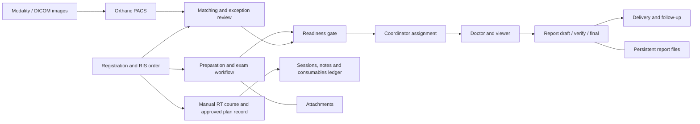

# Architecture and code map

## System boundaries

RadBridge RIS is a Flask application served by Gunicorn. SQLAlchemy models and much of the legacy request orchestration live in `ris/app.py`; extracted modules implement focused policy and services. PostgreSQL is the recorded production database. Jinja templates provide Arabic/English pages. Reports and attachments are persistent files separate from the relational database.

Orthanc supplies PACS image storage/access. `pacs_worker.py` provides background PACS processing in source; this document does not certify every worker as active on the current host. OHIF provides browser imaging; Weasis is a desktop viewer invoked through study-scoped delivery. ONLYOFFICE is the report editor/transport and does not replace RadBridge's report version ledger.

## Modules to inspect for a change

Paths below are relative to `ris/`.

| Area | Primary modules | Important boundary |
|---|---|---|
| Main runtime and schema | `app.py`, `runtime_feature_schema.py`, `schema_check.py` | Import/startup flags and schema management have side effects |
| Registration and scheduling | `registration_policy.py`, `legacy_booking.py`, `scheduling_reference_routes.py`, `procedure_catalog.py` | Patient, order, accession and branch identity |
| Readiness and exam flow | `workflow_engine.py`, `case_readiness_service.py`, `readiness_operations.py`, `reception_readiness.py`, `procedure_staff_workflow.py` | Receiving images must not be treated as ready by assumption |
| Assignment | `case_assignment_service.py`, `assignment_decision_engine.py`, `assignment_distribution.py`, `coordinator_bulk_assignment.py` | Readiness, scope, assignments and audit |
| Matching/correction | `dicom_reconciliation.py`, `pacs_resolution_service.py`, `pacs_resolution_policy.py`, `patient_correction_policy.py`, `patient_demographics.py` | Same-patient confirmation; no silent identity overwrite |
| PACS and transport | `pacs_worker.py`, `dicom_connections.py`, `dicom_node_control.py`, `dicom_echo_worker.py`, `dicom_export_routes.py` | External destination status is distinct from clinical status |
| Viewers and image access | `viewer_choice.py`, `ohif_identity.py`, `pacs_thumbnail.py`, `technician_image_policy.py` | Study-scoped access; external client requirements |
| Reports | `report_transaction_writer.py`, `report_state_transition.py`, `report_version_safety.py`, `onlyoffice_report_bridge.py`, `report_storage_safety.py` | A saved editor buffer is not a committed report version |
| Corrections and finance | `report_revisions.py`, `report_revision_editor.py`, `replacement_settlements.py` | Preserve original final versions and posted payments |
| Reports/analytics exports | `report_exports.py`, `physician_final_counts.py`, `physician_report_workload.py` | Report filters, permissions and export correctness |
| User access | `user_access_policy.py`, `clinical_scope.py`, `user_csv_transfer.py` | Role permissions plus branch/modality/device/room scope |
| Staff worklists | `staff_worklist_filters.py`, `technician_queue.py`, `procedure_staff_workflow.py` | Per-user views; procedure-specific responsibilities |
| Security view | `security_dashboard.py` | Host collector/VPN controls are external operating-system components |
| Manual radiotherapy | `radiotherapy.py`, `radiotherapy_migration.py` | Approved external plan record, immutable versions and session ledger |
| UI | `templates/`, `static/`, `ui_localization.py` | Test both languages, desktop and narrow widths |
| Backups | `backup_worker.py`, storage modules | Presence of a backup worker is not proof of a successful restore |

## Schema and contracts

The [ORM inventory](ORM_INVENTORY.md) lists static declarations; it is not a dump or certification of the live schema. Review `migrations/`, `migrations-safe/`, schema helpers and the actual database before applying a change. The six new RT tables use a separate additive migration.

The [route inventory](ROUTE_INVENTORY.md) includes HTML/form routes as well as JSON endpoints. It is not an OpenAPI contract: response schemas, decorators, callbacks and dynamically registered paths require source review. Existing UI forms rely on session authentication and module-specific CSRF protection.
